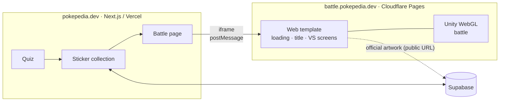

# Pokepedia Battle

A Game Boy–style 1:1 Pokémon turn-based battle. It's the last step of [Pokepedia](https://pokepedia.dev)'s **quiz → sticker collection → battle** loop, built in Unity and running right in the browser.

**[battle.pokepedia.dev](https://battle.pokepedia.dev)** — play the demo without signing in (desktop and mobile browsers)

| | |
|---|---|
|  |  |

## Overview

- **Pikachu vs Blastoise.** One matchup is public, and both Pokémon have their own dedicated move effects. Earn a Pikachu sticker in the Pokepedia quiz and you can battle with your own Pikachu.
- **Rules.** Each Pokémon has three moves (Tackle + two typed moves). Type matchups across all 18 types, physical/special split, accuracy and critical hits are calculated. No PP or status conditions.
- **Data-driven.** Species, moves, roster and effect assignments live in JSON, and the engine doesn't know how many Pokémon are supported. The roster defines 6 Pokémon (a subset of the original 151); the other 4 are kept as data only.
- **English, Korean and Japanese.**

## Architecture

- No game server or database. Pokepedia embeds the game in an iframe and hands over the player's owned Pokémon once via `postMessage` (`ready` → `init`, then `battleEnded`). Both sides check the origin — see the protocol in [PROJECT.md 9.2](docs/PROJECT.md).
- Without `?host=pokepedia` in the URL, the game starts straight into demo mode.
- The title and VS screens are drawn in HTML/CSS by the web template; Unity takes over with pixel art from the battle screen on.

## Visuals

- The world (sprites, Light2D, bloom and color grading, parallax background, rain and fog) and the HUD (uGUI) are rendered separately, and an integer-scaled pixel camera keeps the 240×216 pixel art crisp.
- The background is dithered pixel art drawn in code, and the hit flash is a custom shader.
- Sound effects and typed attack sounds are synthesized in code, with no original audio.

## Tech stack

| | |
|---|---|
| Game | Unity 6.3 LTS, C# 9, URP 2D, uGUI + TextMesh Pro |
| Tests | NUnit, `dotnet test` (GitHub Actions) |
| Hosting | WebGL (pre-compressed Brotli), Cloudflare Pages |
| Integration | Pokepedia (Next.js, Vercel, Supabase) — iframe + `postMessage` |

## Docs

Written in Korean.

- [PROJECT.md](docs/PROJECT.md) — design, battle rules, Pokepedia integration protocol
- [ROADMAP.md](docs/ROADMAP.md) — current status and milestones
- [DEVELOPMENT.md](docs/DEVELOPMENT.md) — directory layout, build and deploy commands

## License

- Code: [MIT](LICENSE)
- Font: [Galmuri](https://github.com/quiple/galmuri) © Lee Minseo, SIL OFL 1.1 → `Assets/Content/Fonts/Galmuri-OFL.txt`
- Pokémon and all related names and artwork belong to Nintendo, The Pokémon Company, Creatures Inc. and GAME FREAK inc., and are not covered by the MIT License. This is an unofficial, non-commercial fan project, and no sprites are included in this repository.
