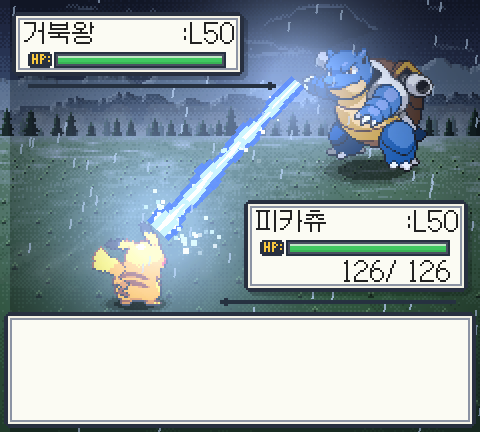
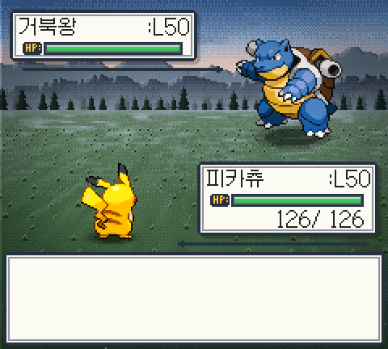

# Pokepedia Battle (Unity)

[Pokepedia](https://pokepedia.dev)의 **퀴즈 → 띠부띠부씰 컬렉션 → 배틀** 루프 중 배틀을 맡는 Unity 2D 턴제 배틀 게임입니다. 게임보이 감성의 1:1 포켓몬 배틀을 브라우저에서 바로 할 수 있습니다.

**▶ 플레이: https://battle.pokepedia.dev** (로그인 없이 Demo 모드, PC·모바일 브라우저)

| 기술 선택 | 10만볼트 |
|---|---|
|  |  |
| **하이드로펌프** | **승리 — 비가 그치고 노을 진 하늘** |
|  |  |

## 지원 범위 (정확한 수)

- **지금 공개된 Demo: 피카츄 vs 거북왕 1매치업.** 두 포켓몬은 전용 연출(Showcase 품질)을 적용했습니다.
- 로스터 데이터에는 **6종**(피카츄·거북왕·리자몽·이상해꽃·팬텀·뮤츠)이 공통 전투 시스템으로 정의돼 있습니다. 나머지 4종은 Pokepedia 연동(Collection 모드)과 공통 연출 확인 뒤 공개합니다.
- **배틀 지원 포켓몬은 1세대 151종 중 일부입니다.** 로스터는 데이터(`roster.json`)로 관리하며 엔진은 지원 포켓몬 수를 모릅니다.
- 포켓몬마다 기술 3개(몸통박치기 + 속성 기술 2개)이고, 상성·물리/특수·명중·급소를 계산합니다. PP·상태이상은 없습니다.

## 보여 주고 싶은 것

- **규칙은 순수 C#, 화면은 Unity.** 전투 엔진(상성 18×18, 능력치·데미지, 명중·급소, 턴 순서, NPC AI)은 `UnityEngine`을 참조하지 않는 어셈블리입니다. NUnit 테스트 102개가 Unity 없이 `dotnet test`로 돌고, 규칙 코드가 바뀐 PR은 GitHub Actions에서 검증합니다.
- **이벤트 로그 → 연출 디렉터.** 엔진은 "기술 사용·피해·급소·기절" 같은 이벤트만 내고, 화면이 그 목록을 차례로 재생합니다. 그래서 규칙과 연출이 서로를 모릅니다.
- **2.5D 화면 연출.** 월드(스프라이트·Light2D·후처리 Bloom/색 보정·패럴랙스 배경·비 파티클·안개 레이어)와 HUD(uGUI, 후처리 제외)를 따로 렌더링하고, 정수 배율 픽셀 카메라로 도트를 유지합니다. 배경은 코드로 그린 디더링 도트 그림이고, 피격 번쩍임은 직접 쓴 셰이더입니다.
- **데이터 주도 콘텐츠.** 종·기술·로스터·연출 강도·전용 연출 배정을 JSON으로 관리하고, 기술은 타입에서 자동 배정합니다. 한국어·영어·일본어 로케일을 지원합니다.
- **웹 배포.** Unity WebGL 빌드를 Brotli로 미리 압축해 Cloudflare Pages에 올리고, 응답 헤더(`Content-Encoding`, `application/wasm`, `frame-ancestors`)를 직접 맞췄습니다. 데스크톱 75 FPS(모니터 상한), 아이폰 Safari 50~60 FPS로 측정했습니다.
- **Pokepedia 연동 규약.** 서버·DB 없이 iframe + `postMessage`(origin 검증)로 보유 포켓몬 목록을 한 번 받습니다 → [docs/PROJECT.md 9.2](docs/PROJECT.md)

## 기술 스택

- Unity 6.3 LTS (6000.3.26f1), C# 9, uGUI + TextMesh Pro, URP 2D (Light2D, Volume 후처리)
- 웹(WebGL) 빌드, Cloudflare Pages(`battle.pokepedia.dev`). Pokepedia(Next.js, Vercel)에서는 iframe으로, 단독으로도(Demo 모드) 실행합니다.
- 기획·설계·연동 규약: [docs/PROJECT.md](docs/PROJECT.md) (확정/위임/미정 사항) · 단계별 진행: [docs/ROADMAP.md](docs/ROADMAP.md)

## 진행 상태

마일스톤 현황과 진행 기록은 [docs/ROADMAP.md](docs/ROADMAP.md)에서 관리합니다.

## 구조

```text
Assets/
  Scripts/
    Domain/        Pokepedia.Domain        순수 C#, UnityEngine 참조 금지 (모델, Battle/ 엔진·이벤트, Rules/ 상성·능력치·데미지, IRandom)
    Content/       Pokepedia.Content       순수 C# (JSON 파서, 데이터 로더·카탈로그, 로케일)
    Application/   Pokepedia.Application   순수 C#, 네임스페이스 Pokepedia.App (NPC AI, 시뮬레이터, 연결 흐름, IHostBridge)
    Bridge/        Pokepedia.Bridge        IHostBridge 의 Unity/WebGL 구현 + HostBridge.jslib
    Presentation/  Pokepedia.Presentation  화면·입력·연출 (규칙 판단 금지)
  Editor/          ProjectSetup, FontAtlasBuilder, WebBuild
  Tests/EditMode/  NUnit 테스트 (UnityEngine 미사용 → dotnet 에서도 실행)
  Content/         Data(species·moves·roster.json), Locale(ko/en/ja), Fonts(Galmuri11 + Static 아틀라스), Sprites(생성물, 커밋 안 함)
  WebGLTemplates/Pokepedia/  웹 템플릿 (10:9 화면, 키 입력 차단, origin 검증)
Tests.Dotnet/      Unity 없이 순수 C# 테스트를 돌리는 프로젝트 (소스 링크)
Tools/             sprites(스프라이트 재현), web(로컬 서버·모의 호스트), audio(속성 공격음 시제품·렌더 도구), unity
docs/              PROJECT.md(기획·설계·연동 규약), ROADMAP.md(진행 기록, M0 결과), 스프라이트 스타일 비교 페이지
```

의존 방향: `Presentation → Application → Domain`, `Bridge → Application`(인터페이스 구현), `Application → Content → Domain`.

`Pokepedia.Application` 어셈블리의 네임스페이스를 `Pokepedia.App`으로 둔 이유: `Pokepedia.Application` 네임스페이스가 있으면 `Pokepedia.*` 안의 모든 코드에서 `UnityEngine.Application`이 가려져 컴파일 오류가 납니다.

## 처음 설정

1. Unity Hub에서 6000.3.26f1 + **Web Build Support** 모듈 설치
2. 스프라이트 생성 (이미지는 저장소에 없음, PokeAPI/sprites 커밋 SHA로 고정) → [Tools/sprites/README.md](Tools/sprites/README.md)
   ```sh
   py -3 -m venv Tools/sprites/.venv
   Tools/sprites/.venv/Scripts/python -I -m pip install -r Tools/sprites/requirements.txt
   Tools/sprites/.venv/Scripts/python -I Tools/sprites/build_sprites.py
   ```
3. Unity로 프로젝트 열기. 처음 한 번 메뉴 **Pokepedia → Setup Project** 실행(플레이어 설정, 폰트 아틀라스, 진입 씬)

## 테스트

```sh
# Unity 없이 (CI 와 동일)
dotnet test Tests.Dotnet
# Unity Test Runner
unity test . --mode EditMode
```

`Tests.Dotnet/`은 `Assets/Scripts/{Domain,Content,Application}`과 `Assets/Tests/EditMode`의 소스를 복사 없이 링크해 `dotnet test`로 돌립니다. UnityEngine을 참조하지 않으므로 순수 C# 영역이나 테스트에서 실수로 `using UnityEngine;`을 쓰면 dotnet 빌드가 바로 깨집니다. 언어 버전도 C# 9로 고정해 Unity에서 컴파일되지 않는 최신 문법을 CI에서 먼저 잡아냅니다. CI(`.github/workflows/domain-tests.yml`)는 Unity 라이선스 없이 이 테스트를 돌립니다. Actions 사용 시간을 아끼려고 **PR에서만**, 그것도 테스트 대상 코드가 바뀐 경우에만 돕니다(초안 PR 제외).

테스트는 꼭 필요한 최소한만 둡니다(규칙·계약 위주, 대표 사례만). 기준은 [CLAUDE.md](CLAUDE.md)의 "지킬 것"을 따릅니다.

## 웹 빌드와 로컬 실행

```sh
# Release (Brotli, Runtime Speed, LTO 없음). Dev 는 WebBuild.Dev
"C:\Program Files\Unity\Hub\Editor\6000.3.26f1\Editor\Unity.exe" -batchmode -quit -projectPath . -executeMethod Pokepedia.EditorTools.WebBuild.Release -logFile Logs/build-web.log
# 사전 압축 파일(.br)에 맞는 헤더로 서빙
python -I Tools/web/serve.py --dir Builds/Web --port 8001 --ancestors http://localhost:8000
# 모의 Pokepedia (iframe + ready/init 왕복 테스트)
python -I Tools/web/serve.py --dir Tools/web/host-test --port 8000
```

- 단독 실행: `http://localhost:8001/` → Demo 모드
- iframe 실행: `http://localhost:8000/` → `?host=pokepedia`로 열려 `ready` → `init` 왕복
- `serve.py --mbps 9 --latency-ms 60`으로 Fast 4G 근사 속도에서 로딩을 잴 수 있습니다.
- 같은 와이파이의 휴대폰으로 열려면 `--host 0.0.0.0`을 붙이고(Windows 방화벽 허용 필요) 휴대폰에서 `http://<PC의 IP>:<포트>/?fps`를 엽니다. `?fps`는 왼쪽 위에 FPS와 가장 느린 프레임(ms)을 보여 줍니다.

## 배포 (Cloudflare Pages)

```sh
# Release 빌드 뒤. wrangler 로그인 필요(npx wrangler login)
python -I Tools/web/deploy.py                 # 본 배포 → https://pokepedia-battle.pages.dev
python -I Tools/web/deploy.py --branch test   # 미리보기 → https://test.pokepedia-battle.pages.dev
```

- 헤더 규칙은 `Tools/web/_headers`(PROJECT.md 10.3). 로컬 `serve.py`도 같은 규칙을 흉내 냅니다.

## 라이선스·고지

- 코드: MIT (예정)
- 폰트: [Galmuri](https://github.com/quiple/galmuri) © Lee Minseo, SIL OFL 1.1 → `Assets/Content/Fonts/Galmuri-OFL.txt`
- 포켓몬 및 포켓몬 스프라이트의 권리는 Nintendo, Creatures Inc., GAME FREAK inc.에 있습니다. 이 프로젝트는 비공식·비영리 팬 프로젝트이며 스프라이트를 저장소에 포함하지 않습니다.
- 효과음과 기술 사용 시 속성 공격음은 원본 음원을 쓰지 않고 직접 합성합니다(`Tools/audio/type-attack-sounds-prototype.html`). 소리는 Setup 이 `Assets/Resources/Audio/`에 미리 굽습니다(커밋 안 함).
