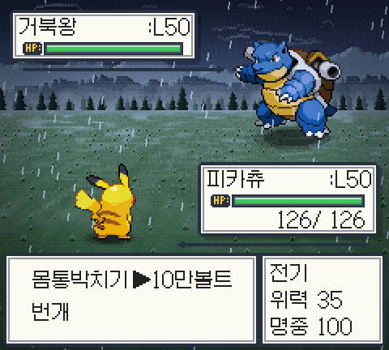
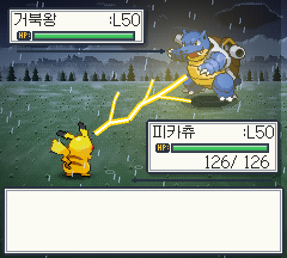
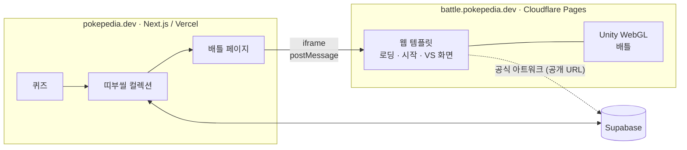

# Pokepedia Battle

게임보이 감성의 1:1 포켓몬 턴제 배틀. [Pokepedia](https://pokepedia.dev)의 **퀴즈 → 띠부씰 컬렉션 → 배틀** 흐름에서 마지막 단계를 맡는 Unity 2D 게임으로, 브라우저에서 바로 실행됩니다.

**[battle.pokepedia.dev](https://battle.pokepedia.dev)** — 로그인 없이 데모로 플레이 (PC·모바일 브라우저)

| | |
|---|---|
|  |  |

## 개요

- **피카츄 vs 거북왕.** 공개된 매치업은 하나이고, 두 포켓몬 모두 전용 연출이 들어가 있습니다. Pokepedia에서 퀴즈로 피카츄 띠부씰을 얻으면 내 피카츄로 배틀할 수 있습니다.
- **규칙.** 포켓몬마다 기술 3개(몸통박치기 + 속성 기술 2개). 18타입 상성, 물리/특수, 명중, 급소를 계산하고 PP·상태이상은 두지 않습니다.
- **데이터 주도.** 종·기술·로스터·연출 배정은 JSON으로 관리하고 엔진은 지원 포켓몬 수를 모릅니다. 로스터에는 6종이 정의돼 있으며(1세대 151종 중 일부), 나머지 4종은 데이터로만 남겨 두었습니다.
- **한국어·영어·일본어.**

## 구조

- 게임 서버와 DB가 없습니다. Pokepedia가 iframe으로 게임을 띄우고, `postMessage`로 보유 포켓몬 목록을 한 번 넘깁니다(`ready` → `init`, 끝나면 `battleEnded`). 양쪽 모두 origin을 검증합니다 — 규약은 [PROJECT.md 9.2](docs/PROJECT.md).
- 주소에 `?host=pokepedia`가 없으면 데모 모드로 바로 시작합니다.
- 시작·VS 화면은 웹 템플릿이 HTML/CSS로 그리고, 도트 그래픽은 전투 화면부터 Unity가 그립니다.

## 화면

- 월드(스프라이트, Light2D, Bloom·색 보정, 패럴랙스 배경, 비·안개)와 HUD(uGUI)를 따로 렌더링하고, 정수 배율 픽셀 카메라로 240×216 도트를 유지합니다.
- 배경은 코드로 그린 디더링 도트, 피격 번쩍임은 직접 쓴 셰이더입니다.
- 효과음과 속성 공격음은 원본 음원 없이 직접 합성합니다.

## 기술 스택

| | |
|---|---|
| 게임 | Unity 6.3 LTS, C# 9, URP 2D, uGUI + TextMesh Pro |
| 테스트 | NUnit, `dotnet test` (GitHub Actions) |
| 배포 | WebGL(Brotli 사전 압축), Cloudflare Pages |
| 연동 | Pokepedia (Next.js, Vercel, Supabase) — iframe + `postMessage` |

## 문서

- [PROJECT.md](docs/PROJECT.md) — 기획, 설계, 전투 규칙, Pokepedia 연동 규약
- [ROADMAP.md](docs/ROADMAP.md) — 현재 상태와 마일스톤
- [DEVELOPMENT.md](docs/DEVELOPMENT.md) — 디렉터리 구조, 빌드·배포 명령

## 라이선스·고지

- 코드: [MIT](LICENSE)
- 폰트: [Galmuri](https://github.com/quiple/galmuri) © Lee Minseo, SIL OFL 1.1 → `Assets/Content/Fonts/Galmuri-OFL.txt`
- 포켓몬과 관련 이름·그림의 권리는 Nintendo, The Pokémon Company, Creatures Inc., GAME FREAK inc.에 있으며 MIT 라이선스에 포함되지 않습니다. 이 프로젝트는 비공식·비영리 팬 프로젝트이며 스프라이트를 저장소에 포함하지 않습니다.
